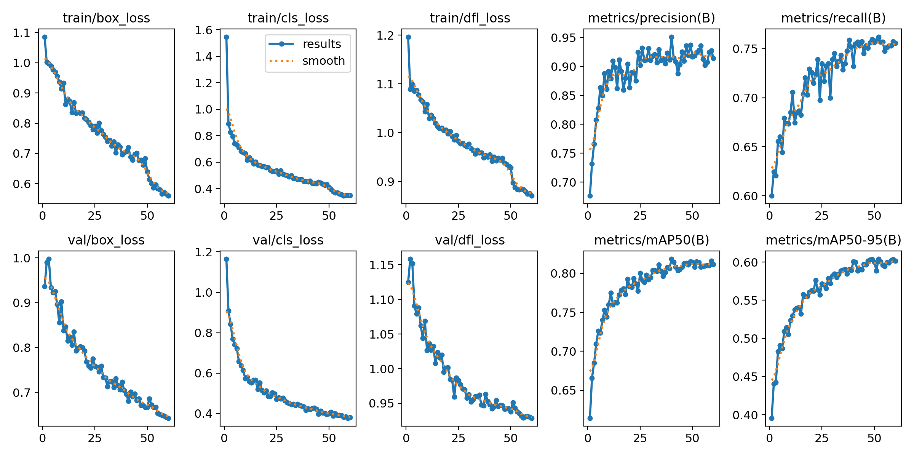
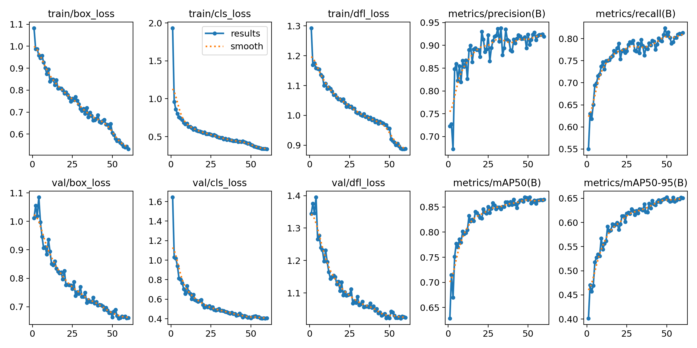
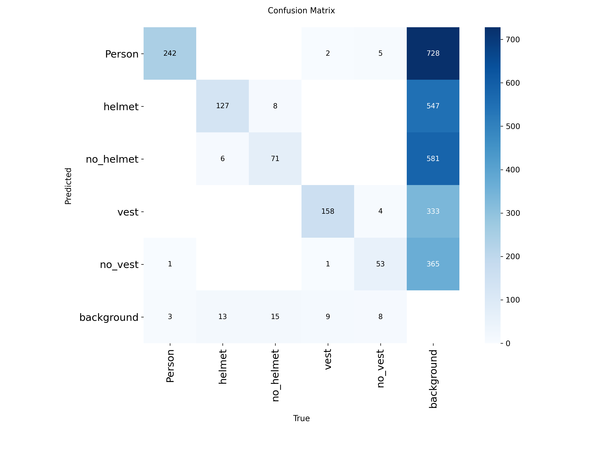
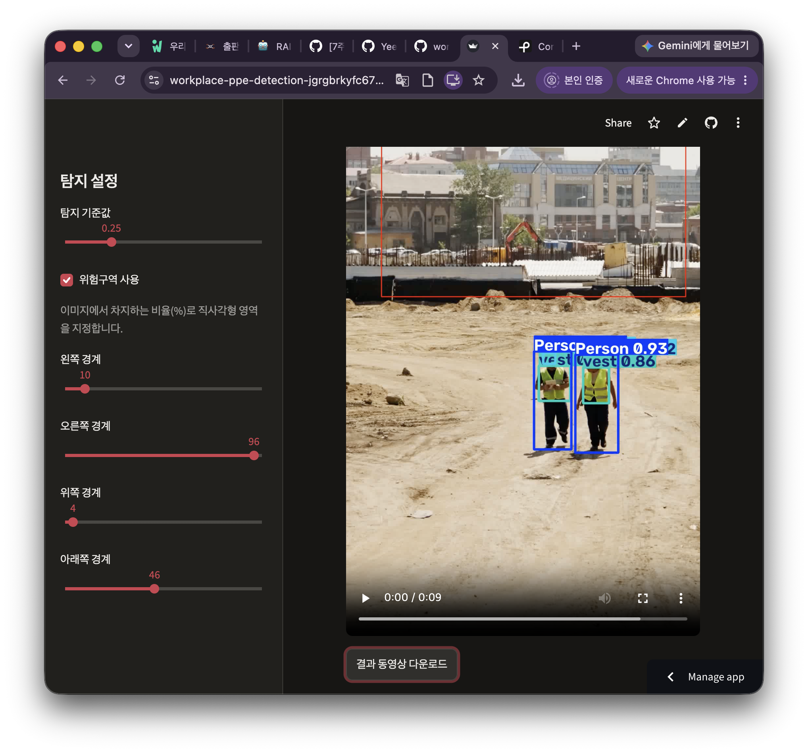
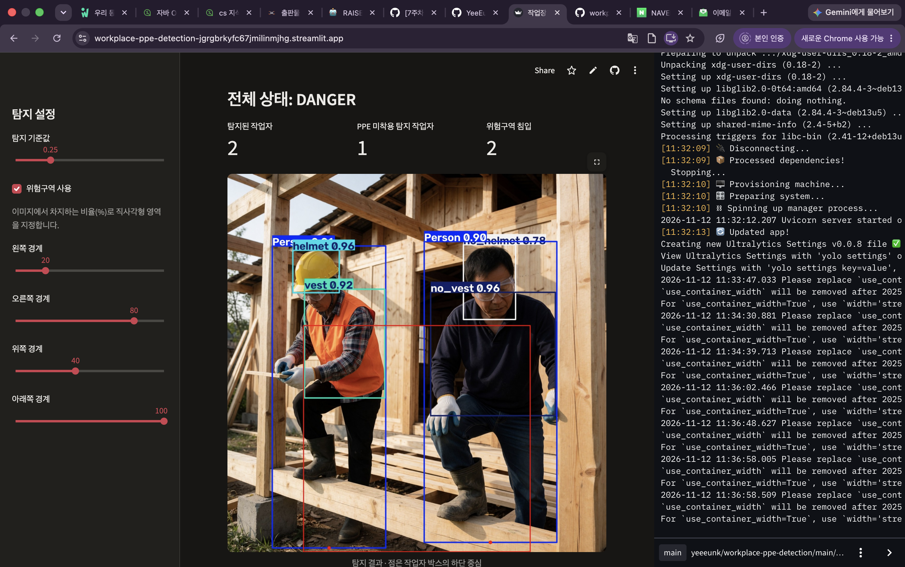
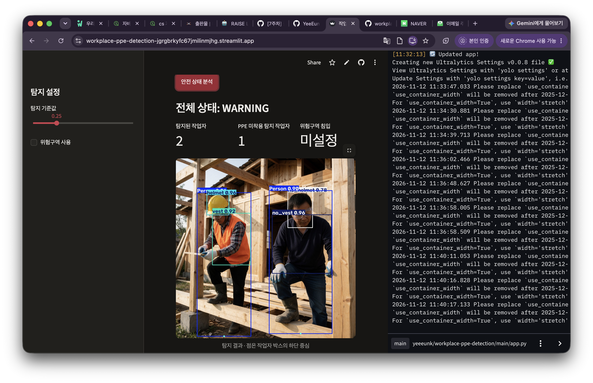
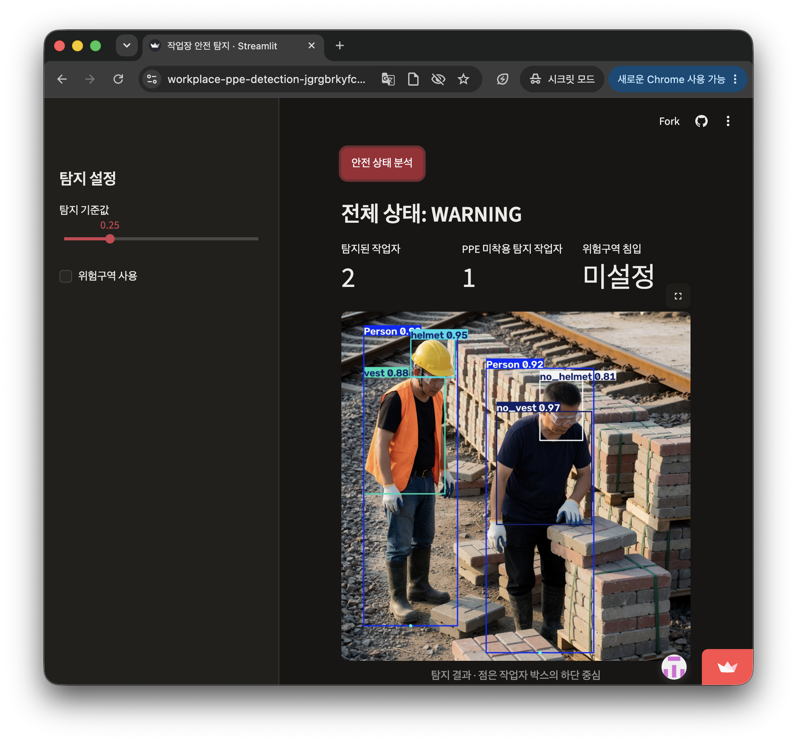

## 0. 프로젝트 정보

- **프로젝트명:** YOLO 기반 작업장 개인보호구 미착용 및 위험구역 침입 탐지 서비스
- **학번 / 이름:** 202439729 / 권이은
- **GitHub:** [프로젝트 저장소](https://github.com/YeeEunK/workplace-ppe-detection)
- **서비스:** [작업장 안전 탐지 앱](https://workplace-ppe-detection-jgrgbrkyfc67jmilinmjhg.streamlit.app/)
- **진행 형태:** 개인 프로젝트 · 교육용 프로토타입

## 1. 문제 정의

작업장에서는 안전모나 안전조끼를 착용하지 않거나 작업자가 위험구역에 들어가는 상황을 놓치지 않는 것이 중요하다. 여러 작업자가 있는 장면에서 이런 상황을 일일이 확인하는 데 도움을 줄 수 있다고 생각해 이 주제를 선택했다. 이미지나 짧은 동영상을 올리면 먼저 확인할 상황을 보여주는 프로그램을 만들고자 했다.

- **Who:** 작업장 안전을 확인하는 관리자
- **What:** 이미지와 짧은 동영상에서 작업자, 안전모와 안전조끼의 착용·미착용을 탐지하고 지정한 위험구역의 침입 여부를 표시한다.
- **When:** 관리자가 작업장 이미지나 짧은 동영상을 올려 안전 상태를 확인할 때
- **Why:** 확인해야 할 상황을 화면에 표시해 작업장 장면 검토를 돕기 위해서다.

[Ultralytics Platform의 Predict 기능](https://docs.ultralytics.com/platform/deploy/inference)은 이미지에 있는 객체의 위치와 종류를 보여준다. 이번 프로젝트에서는 작업장 데이터로 직접 학습한 YOLO 모델을 사용해 작업자와 보호구를 탐지하고, 작업자별 보호구 착용 상태와 사용자가 지정한 위험구역 침입 여부를 함께 보여주도록 구성했다.

**정량 목표:** 실험 결과를 확인한 뒤, 안전모와 안전조끼 미착용 Recall을 각각 0.80 이상으로 높이는 목표를 정했다. 최종 모델의 test Recall은 안전모 미착용 0.682, 안전조끼 미착용 0.633이다.

## 2. 데이터

[Ultralytics Construction-PPE 데이터셋](https://docs.ultralytics.com/datasets/detect/construction-ppe)을 사용했다. 안전모와 조끼의 착용뿐 아니라 눈에 보이는 미착용도 라벨로 제공해서 이 주제에 적합하다고 판단했다. 작업자와 보호구의 위치가 함께 필요했기 때문에 사람 객체의 라벨도 사용했다. 다른 보호구까지 포함하면 범위가 넓어져, 이번에는 사람과 안전모·조끼의 착용 및 미착용에 해당하는 5개 클래스에 집중했다.

- **출처와 라이선스:** Ultralytics team, *Ultralytics Construction-PPE Dataset* (2026), [CC BY 4.0](https://creativecommons.org/licenses/by/4.0/). 출처를 표시하며 공유·변경 조건을 따른다.
- **원본 규모:** 이미지 1,000장, 객체 박스 14,863개, 12개 클래스. 원본 분할은 train 800장 / val 200장이다.
- **구성:** 사람이 수집한 이미지와 생성 이미지가 섞여 있다. NDJSON에서 707장은 `generated`로 표시됐고, 나머지 293장은 해당 출처 표시가 없었다.
- **변경 사항:** 목적에 맞는 5개 클래스를 선택해 ID를 다시 부여하고, 원본 val을 val과 test로 나눴다. 이미지 경계를 벗어난 선택 박스는 경계에 맞게 잘랐다.

| 새 ID | 클래스 | 원본 박스 수 | 포함 이미지 수 |
|---:|---|---:|---:|
| 0 | Person | 2,443 | 991 |
| 1 | helmet | 1,576 | 759 |
| 2 | no_helmet | 813 | 428 |
| 3 | vest | 1,816 | 801 |
| 4 | no_vest | 567 | 384 |

원본 12개 클래스 박스 분포는 helmet 1,576개, gloves 1,929개, vest 1,816개, boots 2,484개, goggles 751개, Person 2,443개, no_helmet 813개, no_goggle 347개, no_gloves 1,042개, no_boots 747개, forklift 348개, no_vest 567개다.

한 이미지에 여러 클래스와 객체가 들어갈 수 있으므로 이미지 수는 서로 겹친다. `no_vest` 박스는 `Person`에 비해 적어서 클래스별 지표를 따로 확인했다. 선택하지 않은 클래스의 라벨은 제거하고 이미지는 유지했으며, 선택 클래스가 없는 8장은 빈 라벨로 남겼다. [클래스 ID 대응표](data/construction-ppe-5class/class_mapping.csv)

원본 학습 데이터(train)는 유지했다. 원본 검증 데이터 200장은 파일명순으로 정렬한 뒤 `seed=42`로 섞어 검증(val)과 테스트(test)에 각각 100장씩 배정했다. 모델은 검증 결과를 바탕으로 선택하고, 테스트 데이터는 마지막 성능 비교에 사용했다. 모델을 고르는 데 사용하지 않은 데이터로 최종 결과를 확인하기 위해서다. [이미지별 분할 기록](data/construction-ppe-5class/split_manifest.csv)

| Split | 이미지 | 선택 객체 | Person | helmet | no_helmet | vest | no_vest |
|---|---:|---:|---:|---:|---:|---:|---:|
| train | 800 | 5,791 | 1,962 | 1,282 | 634 | 1,476 | 437 |
| val | 100 | 726 | 246 | 146 | 94 | 170 | 70 |
| test | 100 | 698 | 235 | 148 | 85 | 170 | 60 |


## 3. 데이터 전처리

원본 박스는 YOLO 형식인 `class x_center y_center width height`로 제공됐다. 클래스 ID를 재배치하고 선택 박스 69개가 이미지 경계를 넘는 부분을 경계에 맞게 수정했다. 전처리 시 이미지와 박스가 함께 바뀌는지 확인하기 위해 [`preprocessing_preview.py`](preprocessing_preview.py)로 같은 이미지에 아래 기법을 적용해 비교했다.

| 기법 | 적용 이유와 박스 처리 |
|---|---|
| 비율을 유지한 크기 조정 및 여백 | 입력 크기를 맞추면서 이미지 왜곡을 줄인다. 크기와 여백에 맞춰 박스 좌표를 바꾼다. |
| 좌우 반전 | 작업자 방향 변화에 대응한다. 박스의 가로 중심을 `1-x`로 바꾼다. |
| 밝기·대비 변화 | 작업장 조명이 다른 상황을 예시로 확인한다. 이미지 안의 위치는 바뀌지 않아 박스 좌표는 그대로 둔다. |

[전처리 비교: 근접 작업자](results/figures/preprocessing_ultralytics-ppe-nov2026-009.jpg) · [전처리 비교: 넓은 작업장](results/figures/preprocessing_source-8c4bd5367bc76d76cd877bc769fbd70a.jpg)

위 그림은 전처리 **확인용 예시**다. 실제 학습에서는 입력 크기 640 또는 960, 좌우 반전 확률 `fliplr=0.5`, 밝기 변화 관련 `hsv_v=0.25`를 설정했다. 그림의 고정 밝기·대비 값이 학습에 그대로 적용된 것은 아니다. val/test에는 무작위 증강을 적용하지 않았다.

## 4. 모델

이 문제에서는 이미지 전체가 안전한지 분류하는 것뿐 아니라 작업자와 보호구가 어디에 있는지도 알아야 한다. 그래서 여러 객체의 위치와 종류를 함께 찾는 객체 탐지 모델 YOLO를 사용했다. 데이터가 1,000장인 점을 고려해 사전학습 가중치를 불러온 뒤 작업장 데이터에 맞게 다시 학습했다.

| 실험 | 모델 | 입력 | epochs | batch | seed |
|---|---|---:|---:|---:|---:|
| Baseline | YOLO11n | 640 | 60 | 8 | 42 |
| 비교 모델 | YOLO26n | 640 | 60 | 8 | 42 |
| 개선 실험 | YOLO11n | 960 | 60 | 8 | 42 |

YOLO11n을 기준 모델로 두고 YOLO26n도 같은 데이터와 주요 설정으로 학습해 모델에 따른 차이를 살펴봤다. 두 모델 모두 가벼운 n 모델을 사용했다. 비교할 때 입력 크기는 640, 학습 횟수는 60 epochs, batch는 8로 맞췄고, seed 42를 기록했다.

학습은 Google Colab의 Tesla T4 GPU에서 진행했다. 기록된 환경은 Python 3.13.16, PyTorch 2.14.1+cu130, Ultralytics 8.4.208이다. 각 실험의 설정과 결과는 [학습 노트북](notebooks/)에서 확인할 수 있다.

두 640 모델의 검증 결과에서 안전모 미착용 Recall이 모두 0.574였다. 미탐 이미지를 살펴보니 먼 거리에서 작업자와 머리가 작게 보이는 경우가 여러 장 있었다. 그래서 입력 크기를 960으로 늘리는 실험을 진행했다. 작은 객체가 탐지에 영향을 줬을 가능성을 살펴보기 위한 실험이다.

## 5. 평가 결과

미착용자를 놓치는 경우를 살펴보기 위해 전체 탐지 성능인 mAP와 함께 미착용 클래스의 Recall을 확인했다. 하나의 지표만 보면 어떤 종류의 탐지를 놓치는지 알기 어렵기 때문이다.

모델은 test를 확인하기 전에 val 결과를 바탕으로 선택했다. 각 모델의 학습 종료 후 best.pt 검증 기록에서 mAP50은 YOLO11n 640이 0.815, YOLO26n 640이 0.823, YOLO11n 960이 0.865였다. 안전모 미착용 Recall은 두 640 모델이 0.574, YOLO11n 960이 0.633이었다. 미착용을 놓치는 경우와 전체 탐지 성능을 함께 고려해 YOLO11n 960을 선택한 뒤 test 결과를 확인했다. 별도 검증 분석 노트북에서 다시 평가한 두 640 모델의 mAP50은 각각 0.811과 0.822로 기록됐다.

### Test 비교

같은 test 이미지 100장과 객체 698개로 평가했다. 각 모델은 학습·검증에 사용한 입력 크기를 사용했다.

| 모델 | Precision | Recall | mAP50 | mAP50-95 | no_helmet Recall | no_vest Recall |
|---|---:|---:|---:|---:|---:|---:|
| YOLO11n 640 | 0.930 | 0.756 | 0.842 | 0.622 | 0.553 | 0.596 |
| YOLO26n 640 | 0.926 | 0.783 | 0.851 | 0.635 | 0.647 | 0.633 |
| **YOLO11n 960** | 0.921 | **0.805** | **0.889** | **0.677** | **0.682** | 0.633 |

Precision은 탐지한 결과가 얼마나 정확한지, Recall은 실제 정답을 얼마나 놓치지 않고 찾았는지를 나타낸다. PPE 미착용은 놓치는 문제가 중요해서 전체 mAP와 함께 클래스별 Recall을 확인했다.  표는 테스트 데이터 전체에 대한 모델 평가 결과다. 서비스에서는 사용자가 설정한 탐지 기준값에 따라 화면에 표시되는 결과가 달라진다.

최종 모델의 test `no_helmet` Recall은 0.682다. 테스트에는 같은 데이터셋에서 분리한 이미지 100장을 사용했다. 새로운 작업장에서도 비슷한 성능이 나오는지 확인하려면 다른 현장에서 촬영한 이미지로 추가 평가할 필요가 있다.

### 오류 확인과 개선

YOLO11n 640의 val에서 안전모 미착용 정답을 포함한 이미지 14장을 확인했다. 멀리 있는 작업자가 여러 장에서 작게 보였다. 또 IoU 0.5 기준으로 탐지 기준값을 0.25에서 0.10으로 낮췄을 때, 정답 94개 중 찾은 수는 59개에서 62개로 늘었지만 정답과 연결되지 않은 탐지는 14개에서 44개로 늘었다.    기준값을 낮추는 것만으로는 추가로 확인할 탐지도 많이 늘어났다. 앞에서 살펴본 이미지에서 멀리 있는 작업자의 머리가 작게 보인 점을 바탕으로, 다음에는 입력 크기를 960으로 늘려 실험했다. 이 분석은 앞의 성능 비교표와 계산 방식이 다르므로 수치를 따로 살펴봤다.

### 안전조끼 미착용 오류 분석

서비스가 안전모와 안전조끼를 함께 다루기 때문에 안전모뿐 아니라 안전조끼 미착용도 확인했다. 최종 모델의 test `no_vest` Recall은 0.633이었다. 이 결과를 확인한 뒤, 추가 분석은 검증 데이터에서 진행했다. 기존 서비스 기준값 0.25와 다른 기준값의 차이도 함께 살펴봤다.

최종 YOLO11n 960 모델로 val 이미지 100장에 있는 안전조끼 미착용 정답 박스 70개를 분석했다. 같은 클래스의 예측과 정답을 IoU 0.5 이상에서 하나씩 연결하고, 신뢰도가 높은 예측부터 계산했다. 기준값을 낮추면 놓친 미착용을 더 찾는지, 정답과 연결되지 않는 탐지도 늘어나는지 함께 확인했다.

| 탐지 기준값 | 찾은 정답 | 놓친 정답 | 정답과 연결되지 않은 탐지 | Recall |
|---:|---:|---:|---:|---:|
| 0.10 | 55 | 15 | 13 | 0.786 |
| 0.25 | 53 | 17 | 6 | 0.757 |
| 0.50 | 48 | 22 | 4 | 0.686 |

기준값을 0.25에서 0.10으로 낮추자 찾은 정답은 2개 늘었지만 정답과 연결되지 않은 탐지는 7개 늘었다. 정답을 찾는 수와 추가로 확인해야 할 탐지를 함께 고려해 기존 기준값 0.25를 유지했다. 오류 이미지에는 작게 보이거나 다른 사람에게 가려진 작업자가 있었다. 박스 위치가 정답과 충분히 겹치지 않거나 정답 라벨이 빠진 경우에도 탐지가 연결되지 않을 수 있다.

표는 고정 기준값으로 따로 계산한 val 결과다. [기준값별 결과](results/vest_val_analysis/threshold_metrics.csv) · [이미지별 결과](results/vest_val_analysis/image_errors.csv) · [분석 코드](analyze_vest_val.py)






- [test 평가 실행 기록](notebooks/06_test_comparison_colab.ipynb)

학습곡선에서는 두 YOLO11n 실험 모두 epoch가 진행되면서 학습·검증 손실이 전반적으로 줄고 val mAP가 높아졌다. 960 실험의 val 결과가 개선됐지만, 곡선과 한 번의 분할만으로 다른 현장에서도 같은 개선이 유지된다고 결론 내리기는 어렵다.  YOLO11n 960의 검증 혼동행렬에서는 안전모 미착용 정답 94개 중 71개를 미착용으로 탐지했고, 8개를 착용으로 분류했으며 15개는 탐지하지 못했다.  이 그림은 학습 후 검증 데이터에서 생성됐고, 위 표는 테스트 데이터의 평가 결과다. 혼동행렬의 개수와 표의 Recall은 계산 조건이 달라 그대로 비교하지 않는다.

## 6. 서비스 프로토타입

학습 결과를 숫자뿐 아니라 이미지에서 직접 확인할 수 있도록 Streamlit으로 간단한 웹 앱을 만들었다. Streamlit 앱에서 JPG 또는 PNG 이미지를 올리면 직접 학습한 `models/best.pt`를 불러와 960 크기로 추론한다. 탐지된 작업자 수, PPE 미착용 탐지 작업자 수, 위험구역 침입 수와 사람별 결과를 표시한다. 탐지 기준값도 조절할 수 있다.

위험한 위치가 작업장마다 다를 수 있어, 사용자가 이미지에 맞춰 위험구역을 지정하도록 했다. 위험구역은 이미지 비율을 조절해 설정하는 직사각형 관심 영역(ROI)이다. YOLO의 `Person` 박스 하단 중심점이 ROI 안에 있으면 침입으로 판정한다. 위험구역 침입 여부는 모델이 찾은 작업자의 위치와 사용자가 지정한 영역을 비교해 판단한다. PPE는 보호구 박스의 중심이 사람 박스 안에 있는지로 연결하며, 사람이 겹칠 때는 가장 작은 사람 박스에 연결하는 단순 규칙이다. 가림이나 겹침이 있으면 연결이 틀릴 수 있다.

고정 카메라 영상에서 위치가 일정한 구역을 확인하기 위해 화면에 고정되는 위험구역을 사용했다. 예를 들어 굴착 구덩이 주변이나 장비 전용 통로를 지정해 작업자의 진입 여부를 살펴볼 수 있다. 작업 상황이 바뀌면 관리자가 구역을 다시 설정한다. 지게차처럼 움직이는 장비 주변을 따라가는 영역은 현재 기능의 범위에 포함되지 않는다.

### 동영상 분석

동영상 메뉴에서 10초 이하, 20MB 이하의 MP4를 올려 분석할 수 있다. 영상 첫 장면에서 위험구역을 미리 확인하고, 분석 후에는 안전모·안전조끼 미착용과 위험구역 침입 감지 여부, 확인이 필요한 장면, 결과 동영상을 확인할 수 있다. 결과 영상은 다운로드할 수 있으며 원본 소리는 포함되지 않는다.

영상은 초당 최대 3장면을 추출해 분석한다. 영상 전체를 연속으로 판정하는 방식이 아니므로 추출한 장면 사이의 상황은 놓칠 수 있다. 결과는 이미지로 학습한 모델을 영상 장면에 적용한 것이며, 고정된 카메라 영상에 맞춰 위험구역이 화면에서 고정된다.

- **DANGER:** 위험구역 침입이 탐지된 경우
- **WARNING:** PPE 미착용이나 착용·미착용 결과 충돌이 탐지된 경우
- **확인 필요:** 작업자가 없거나, 장비·위험구역을 충분히 확인할 수 없는 경우
- **SAFE:** 지정한 위험구역 밖에서 탐지된 작업자의 안전모와 조끼가 모두 착용으로 확인된 경우

위 상태는 모델 예측과 위치 규칙의 결과이며 실제 안전을 보장하지 않는다. 이미지 형식과 크기를 검사한다.

서비스에서 학습 이미지와 val 이미지로 추론을 확인했고, 시크릿 창으로 공개 URL에 접속해 사진 분석이 되는 것도 확인했다.

**동영상 분석 결과 화면**



작업장 영상을 올리고 위험구역을 설정한 뒤 분석한 화면이다. 영상에서 탐지한 작업자와 안전조끼를 상자로 표시하고, 사용자가 지정한 위험구역을 빨간 사각형으로 보여준다. 분석 결과는 동영상으로 재생하거나 다운로드할 수 있다.

시연 영상 출처: Mikael Blomkvist, [Construction Workers Walking at the Construction Site](https://www.pexels.com/video/construction-workers-walking-at-the-construction-site-8965526/), Pexels. [Pexels 라이선스](https://www.pexels.com/license/).

**위험구역 침입 화면**



**PPE 미착용 경고 화면**



**공개 URL 추론 화면**



## 7. 배포

[Streamlit Community Cloud](https://streamlit.io/cloud)에 GitHub 저장소의 `app.py`를 연결했다. 2026-11-12 시크릿 창에서 앱 접속과 이미지 추론을 확인했다. [서비스 열기](https://workplace-ppe-detection-jgrgbrkyfc67jmilinmjhg.streamlit.app/)

배포 중 OpenCV를 불러오지 못하는 문제가 있어 `packages.txt`에 `libgl1`과 `libglib2.0-0`을 추가했다. 반영 후 앱 화면과 추론이 동작하는 것을 확인했다. 

## 8. 실행 방법

학습 환경은 위 4절에 기록했다. 서비스는 저장소 루트에서 Python 환경에 필요한 패키지를 설치한 뒤 실행한다. 모델 파일은 [`models/best.pt`](models/best.pt)에 있다.

```bash
pip install -r requirements.txt
streamlit run app.py
```

1. 앱에서 작업장 JPG/PNG 이미지를 업로드한다.
2. 필요하면 왼쪽에서 위험구역 사용을 켜고 네 경계를 조정한다.
3. `안전 상태 분석`을 눌러 이미지와 작업자별 결과를 확인한다.

동영상은 `동영상`을 선택해 업로드하고, 필요하면 위험구역을 설정한 뒤 `동영상 분석 시작`을 누른다. 분석 요약과 확인 장면을 보고 결과 동영상을 다운로드할 수 있다. 동영상 결과 변환에는 시스템에 설치된 `ffmpeg`가 필요하며, 배포용 시스템 패키지는 `packages.txt`에 기록했다.

업로드 이미지 제한은 15MB 및 2,500만 픽셀이다. 원본 데이터는 저장소에 포함하지 않았다. 원본 YOLO 형식 데이터셋을 내려받은 후 `python prepare_data.py /path/to/construction-ppe --output ./data/construction-ppe-prepared`로 같은 방식의 5개 클래스 데이터를 만들 수 있다. 출력 폴더는 새 폴더이거나 비어 있어야 한다. 학습용 노트북은 Google Drive 경로를 사용하므로 본인 환경에 맞게 경로를 확인해야 한다.

안전조끼 미착용 검증 분석은 위에서 만든 데이터 폴더를 지정해 실행한다. 결과표와 확인 이미지는 `results/vest_val_analysis/`에 저장된다.

```bash
python analyze_vest_val.py --data ./data/construction-ppe-prepared
```

## 9. Lessons Learned

### Plus

1. 원본 데이터에서 작업자와 안전모·안전조끼의 착용 및 미착용에 해당하는 다섯 클래스를 골라 다시 구성했다. 라벨의 클래스 번호와 박스 좌표를 확인하면서 이미지와 정답이 함께 맞아야 모델을 학습하고 평가할 수 있다는 것을 이해했다.
2. 사전학습된 YOLO 모델을 작업장 데이터로 다시 학습하고, 같은 테스트 데이터에서 결과를 비교했다. 전체 성능뿐 아니라 안전모와 조끼 미착용 Recall도 따로 확인해 어떤 항목을 더 놓치는지 살펴볼 수 있었다.
3. 학습한 모델을 이미지와 짧은 동영상 분석에 연결했다. 직접 이미지를 올리고 위험구역을 설정한 뒤 결과를 확인하면서, 모델의 탐지 결과가 사용자에게 어떻게 보이는지도 살펴봤다.

### Minus

1. YOLO11n 640의 검증 안전모 미착용 Recall은 0.574였다. 입력 크기를 늘린 최종 모델의 테스트 Recall도 안전모 미착용은 0.682, 조끼 미착용은 0.633으로, 놓치는 경우가 남아 있다.
2. 작업자와 보호구는 탐지된 박스의 위치를 기준으로 연결한다. 작업자가 겹치거나 보호구가 가려진 장면에서는 연결이 달라질 수 있어 결과 화면에서 함께 확인할 필요가 있다.
3. 위험구역은 화면에 고정된 영역이어서 고정 카메라에서 위치가 일정한 장소를 확인하는 데 적합하다. 지게차처럼 움직이는 장비 주변을 확인하려면 별도의 방법이 필요하다.

### Interesting

1. YOLO11n 640의 검증 결과에서 안전모 미착용 탐지 기준값을 0.25에서 0.10으로 낮췄을 때, 찾은 정답은 59개에서 62개로 늘었지만 정답과 연결되지 않은 탐지는 14개에서 44개로 늘었다. 기준값을 낮추면 놓치는 대상을 줄일 수 있지만, 함께 확인해야 할 탐지도 늘어날 수 있다는 것을 알게 됐다.
2. 입력 크기를 640에서 960으로 바꾸자 검증 mAP50은 0.815에서 0.865로, 안전모 미착용 Recall은 0.574에서 0.633으로 높아졌다. 학습 시간도 약 29.6분에서 38.5분으로 늘어 성능과 시간 모두를 함께 살펴봐야 했다.
3. 최종 모델로 안전조끼 미착용을 추가 분석했을 때도 기준값 0.25에서 0.10으로 낮추면 찾은 정답이 53개에서 55개로 늘었고, 정답과 연결되지 않은 탐지는 6개에서 13개로 늘었다. 정답을 찾는 수와 추가로 확인할 탐지를 함께 고려해 서비스 기준값은 0.25를 유지했다.

### 문제 해결 사례

- **문제:** Streamlit에 앱을 배포했을 때 화면이 열리지 않고 OpenCV를 불러오는 단계에서 오류가 발생했다.
- **원인 확인:** 실행 로그에 libGL.so.1과 libgthread-2.0.so.0을 찾지 못한다는 메시지가 나타났다. OpenCV 실행에 필요한 시스템 라이브러리가 배포 환경에 없었기 때문이다.
- **시도:** packages.txt에 libgl1과 libglib2.0-0을 추가하고 변경 사항을 반영했다.
- **결과:** 앱 화면이 다시 열렸고, 공개 주소에 접속해 이미지를 올린 뒤 탐지 결과가 나오는 것을 확인했다. 오류가 생겼을 때 실행 로그에서 실제 원인을 확인하는 과정이 중요하다는 것을 배웠다.

### 앞으로의 개선

- **데이터:** 새로운 현장과 카메라에서 촬영한 이미지로 모델을 확인하고, 멀리 있거나 다른 작업자에게 가려진 미착용 사례를 더 살펴보고 싶다. 현재 데이터와 다른 환경에서도 탐지할 수 있는지 확인하기 위해서다.
- **모델:** 안전모와 조끼 미착용의 오탐·미탐 사례를 검토하고, 다양한 작업장 이미지를 추가해 Recall 개선을 시도한다. 검증 데이터로 개선 방향을 정한 뒤 별도의 데이터로 결과를 확인한다.
- **서비스:** 작업자가 겹치는 장면에서 사람과 보호구 연결이 잘 되는지, 지정한 위험구역의 침입 판정이 맞는지 정답 사례를 만들어 평가한다. 앞으로는 움직이는 지게차 주변처럼 상황에 따라 바뀌는 위험구역을 처리하는 방법도 살펴보고 싶다.
