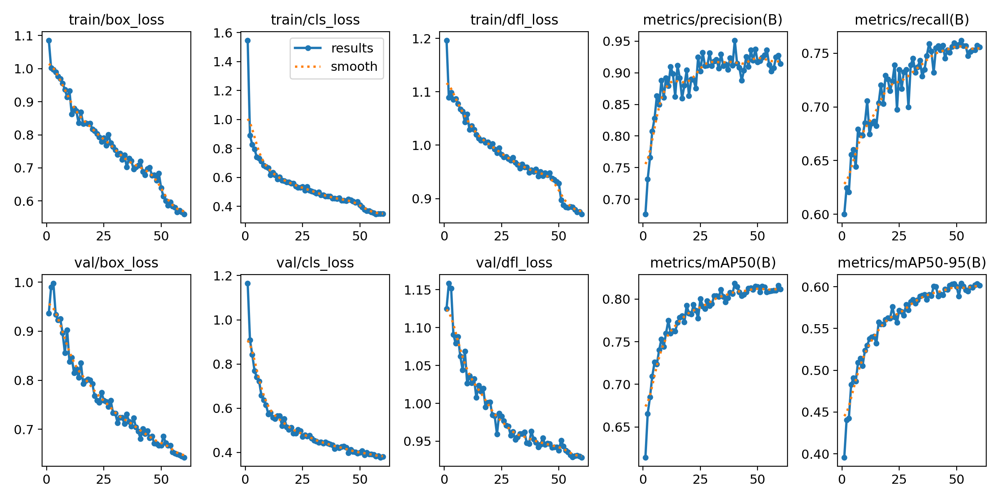
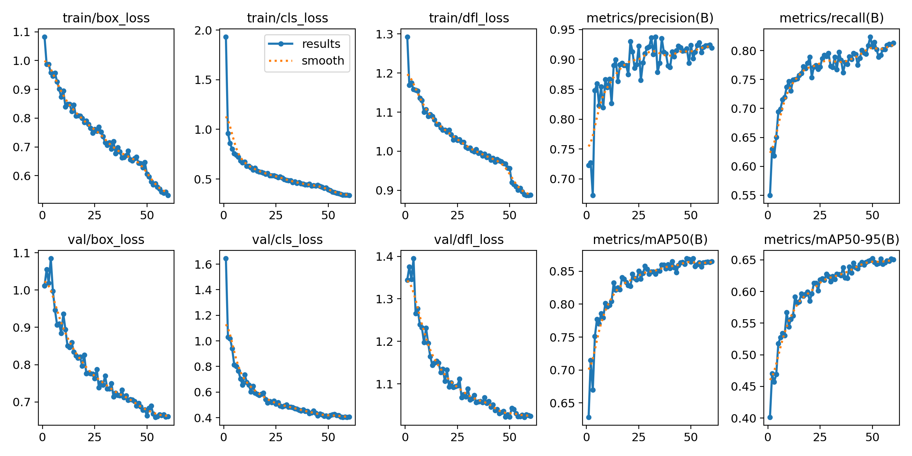
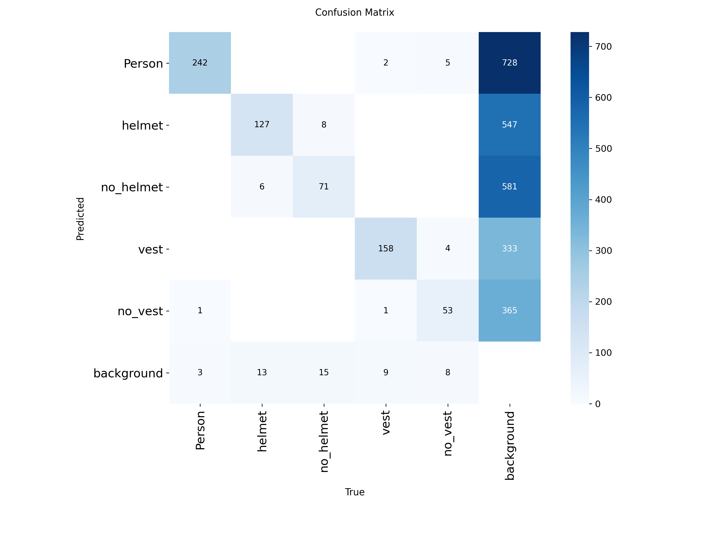
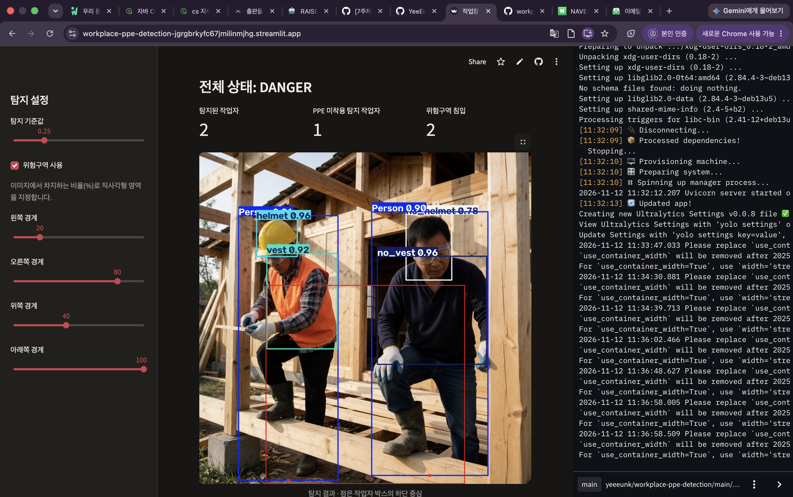
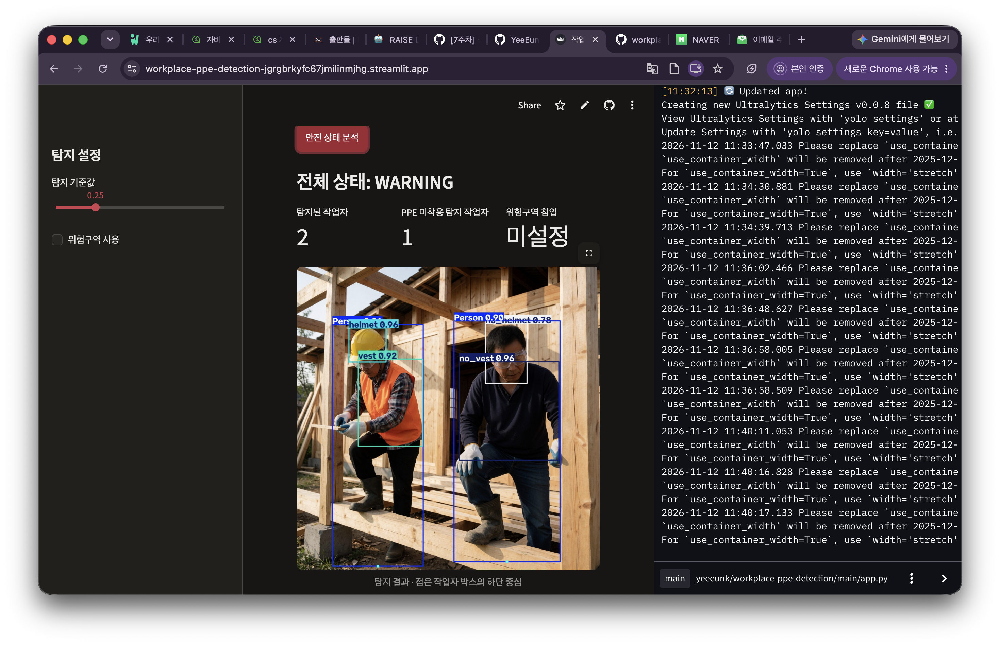
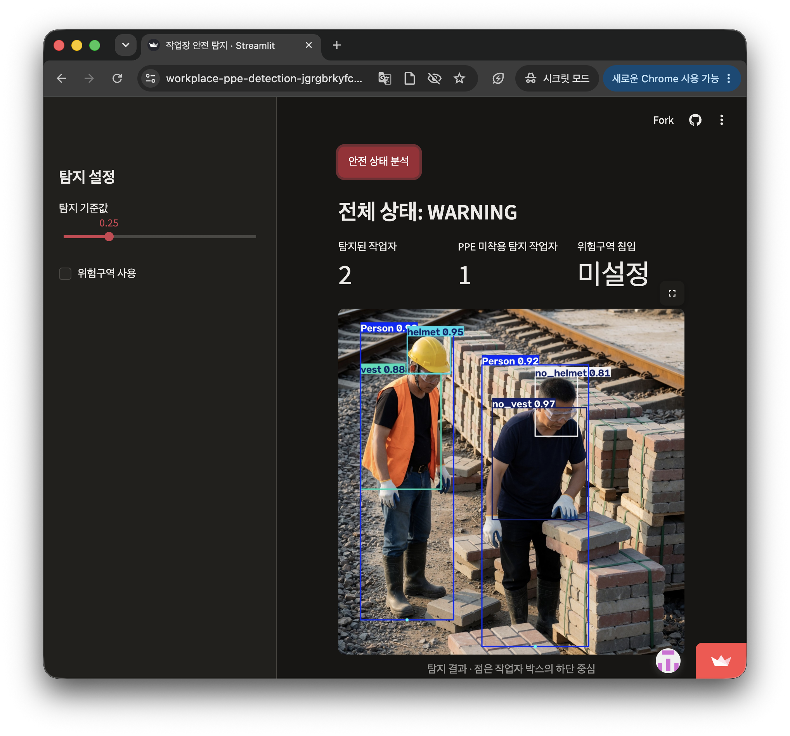

## 0. 프로젝트 정보

- **프로젝트명:** YOLO 기반 작업장 개인보호구 미착용 및 위험구역 침입 탐지 서비스
- **학번 / 이름:** 202439729 / 권이은
- **GitHub:** [프로젝트 저장소](https://github.com/YeeEunK/workplace-ppe-detection)
- **서비스:** [작업장 안전 탐지 앱](https://workplace-ppe-detection-jgrgbrkyfc67jmilinmjhg.streamlit.app/)
- **진행 형태:** 개인 프로젝트 · 교육용 프로토타입

## 1. 문제 정의

작업장에서는 안전모나 안전조끼를 착용하지 않거나, 작업자가 위험구역에 들어가는 상황을 놓치지 않는 것이 중요하다. 사람이 여러 카메라 화면을 계속 확인하기는 어렵기 때문에, 이미지에서 확인이 필요한 상황을 먼저 표시하는 프로토타입을 만들고자 했다.

- **Who:** 작업장 안전을 확인하는 관리자
- **What:** 이미지에서 작업자, 안전모와 안전조끼의 착용·미착용을 탐지하고 지정한 위험구역의 침입 여부를 표시한다.
- **When:** 관리자가 작업장 이미지를 올려 안전 상태를 확인할 때
- **Why:** 확인해야 할 상황을 화면에 표시해 이미지 검토를 돕기 위해서다.

비교 대상으로 살펴본 [Ultralytics Platform의 Predict 기능](https://docs.ultralytics.com/platform/deploy/inference)은 이미지를 올려 탐지 상자와 결과를 확인할 수 있다. 이 프로젝트는 그 결과를 작업자별 PPE 상태, 사용자가 지정한 위험구역 침입 여부와 전체 상태로 이어서 보여주도록 구성했다. 두 서비스를 같은 조건에서 직접 사용하거나 성능을 비교한 것은 아니므로 우열을 주장하지 않는다.

**정량 목표에 대한 기록:** 초기 실험 전에 고정해 둔 목표치는 없다. 비교 지표로 mAP50, mAP50-95와 안전모·조끼 미착용 Recall을 사용했다. 이후 개선 목표로는 안전모 미착용 Recall 향상이 중요하다고 판단했지만, 결과를 보고 정한 수치를 사전에 설정한 목표처럼 쓰지는 않았다. 향후 독립 데이터에서 미착용 Recall 0.80 이상을 목표로 추가 검증할 수 있다.

## 2. 데이터

[Ultralytics Construction-PPE 데이터셋](https://docs.ultralytics.com/datasets/detect/construction-ppe)을 사용했다. 안전모와 조끼의 착용뿐 아니라 눈에 보이는 미착용도 라벨로 제공해서 이 주제에 적합하다고 판단했다.

- **출처와 라이선스:** Ultralytics team, *Ultralytics Construction-PPE Dataset* (2026), [CC BY 4.0](https://creativecommons.org/licenses/by/4.0/). 출처를 표시하며 공유·변경 조건을 따른다.
- **원본 규모:** 이미지 1,000장, 객체 박스 14,863개, 12개 클래스. 원본 분할은 train 800장 / val 200장이다.
- **구성:** 사람이 수집한 이미지와 생성 이미지가 섞여 있다. NDJSON에서 707장은 `generated`로 표시됐고, 나머지 293장은 해당 출처 표시가 없었다.
- **변경 사항:** 목적에 맞는 5개 클래스를 선택해 ID를 다시 부여하고, 원본 val을 val과 test로 나눴다. 이미지 경계를 벗어난 선택 박스는 경계에 맞게 잘랐다.

| 새 ID | 클래스 | 원본 박스 수 | 포함 이미지 수 |
|---:|---|---:|---:|
| 0 | Person | 2,443 | 991 |
| 1 | helmet | 1,576 | 759 |
| 2 | no_helmet | 813 | 428 |
| 3 | vest | 1,816 | 801 |
| 4 | no_vest | 567 | 384 |

원본 12개 클래스 박스 분포는 helmet 1,576개, gloves 1,929개, vest 1,816개, boots 2,484개, goggles 751개, Person 2,443개, no_helmet 813개, no_goggle 347개, no_gloves 1,042개, no_boots 747개, forklift 348개, no_vest 567개다.

한 이미지에 여러 클래스와 객체가 들어갈 수 있으므로 이미지 수는 서로 겹친다. `no_vest` 박스는 `Person`에 비해 적어서 클래스별 지표를 따로 확인했다. 선택하지 않은 클래스의 라벨은 제거하고 이미지는 유지했으며, 선택 클래스가 없는 8장은 빈 라벨로 남겼다. [클래스 ID 대응표](data/construction-ppe-5class/class_mapping.csv)

원본 train은 유지하고 원본 val 200장을 파일명 정렬 후 `seed=42`로 섞어 각각 100장씩 val과 test에 배정했다. 모델 선택은 val 결과로 했고 test는 최종 비교에 사용했다. [이미지별 분할 기록](data/construction-ppe-5class/split_manifest.csv)

| Split | 이미지 | 선택 객체 | Person | helmet | no_helmet | vest | no_vest |
|---|---:|---:|---:|---:|---:|---:|---:|
| train | 800 | 5,791 | 1,962 | 1,282 | 634 | 1,476 | 437 |
| val | 100 | 726 | 246 | 146 | 94 | 170 | 70 |
| test | 100 | 698 | 235 | 148 | 85 | 170 | 60 |

데이터 출처가 같은 이미지 분할이므로, 이 test 결과만으로 새로운 현장이나 카메라에서도 같은 성능이 나온다고 단정할 수 없다.

## 3. 데이터 전처리

원본 박스는 YOLO 형식인 `class x_center y_center width height`로 제공됐다. 클래스 ID를 재배치하고 선택 박스 69개가 이미지 경계를 넘는 부분을 경계에 맞게 수정했다. 전처리 시 이미지와 박스가 함께 바뀌는지 확인하기 위해 [`preprocessing_preview.py`](preprocessing_preview.py)로 같은 이미지에 아래 기법을 적용해 비교했다.

| 기법 | 적용 이유와 박스 처리 |
|---|---|
| 비율을 유지한 크기 조정 및 여백 | 입력 크기를 맞추면서 이미지 왜곡을 줄인다. 크기와 여백에 맞춰 박스 좌표를 바꾼다. |
| 좌우 반전 | 작업자 방향 변화에 대응한다. 박스의 가로 중심을 `1-x`로 바꾼다. |
| 밝기·대비 변화 | 작업장 조명이 다른 상황을 예시로 확인한다. 이미지 안의 위치는 바뀌지 않아 박스 좌표는 그대로 둔다. |

[전처리 비교: 근접 작업자](results/figures/preprocessing_ultralytics-ppe-nov2026-009.jpg) · [전처리 비교: 넓은 작업장](results/figures/preprocessing_source-8c4bd5367bc76d76cd877bc769fbd70a.jpg)

위 그림은 전처리 **확인용 예시**다. 실제 학습에서는 입력 크기 640 또는 960, 좌우 반전 확률 `fliplr=0.5`, 밝기 변화 관련 `hsv_v=0.25`를 설정했다. 그림의 고정 밝기·대비 값이 학습에 그대로 적용된 것은 아니다. val/test에는 무작위 증강을 적용하지 않았다.

## 4. 모델

수업에서 다룬 YOLO의 전이학습 방식을 따라 사전학습 가중치를 불러온 뒤 이 데이터로 직접 학습했다. 처음부터 학습하는 것보다 적은 데이터로 탐지 문제에 접근할 수 있고, 수업에서 배운 YOLO 형식과 학습 과정을 그대로 연결할 수 있어서 선택했다.

| 실험 | 모델 | 입력 | epochs | batch | seed |
|---|---|---:|---:|---:|---:|
| Baseline | YOLO11n | 640 | 60 | 8 | 42 |
| 비교 모델 | YOLO26n | 640 | 60 | 8 | 42 |
| 개선 실험 | YOLO11n | 960 | 60 | 8 | 42 |

학습은 Google Colab의 Tesla T4 GPU에서 진행했다. 기록된 환경은 Python 3.13.16, PyTorch 2.14.1+cu130, Ultralytics 8.4.208이다. 비교 모델은 같은 데이터와 주요 학습 설정을 사용했고, 960 실험은 YOLO11n baseline에서 입력 크기를 바꿨다. 실행 로그가 포함된 [학습 노트북](notebooks/)을 보관했다.

두 640 모델의 검증 결과에서 안전모 미착용 Recall이 모두 0.574였다. 미탐 이미지를 살펴보니 먼 거리에서 작업자와 머리가 작게 보이는 경우가 여러 장 있었다. 그래서 입력 크기를 960으로 늘리는 실험을 진행했다. 작은 객체가 영향을 줬을 가능성을 확인하기 위한 시도이며, 모든 미탐의 원인을 확정한 것은 아니다.

## 5. 평가 결과

모델 선택은 **val 결과로 먼저** 했다. YOLO11n 960은 640 baseline보다 val mAP50이 0.815에서 0.865, 안전모 미착용 Recall이 0.574에서 0.633으로 높아져 최종 모델로 선택했다. 그 후 test 결과를 확인했다.

### Test 비교

같은 test 이미지 100장과 객체 698개로 평가했다. 각 모델은 학습·검증에 사용한 입력 크기를 사용했다.

| 모델 | Precision | Recall | mAP50 | mAP50-95 | no_helmet Recall | no_vest Recall |
|---|---:|---:|---:|---:|---:|---:|
| YOLO11n 640 | 0.930 | 0.756 | 0.842 | 0.622 | 0.553 | 0.596 |
| YOLO26n 640 | 0.926 | 0.783 | 0.851 | 0.635 | 0.647 | 0.633 |
| **YOLO11n 960** | 0.921 | **0.805** | **0.889** | **0.677** | **0.682** | 0.633 |

Precision은 탐지한 결과가 얼마나 정확한지, Recall은 실제 정답을 얼마나 놓치지 않고 찾았는지를 나타낸다. PPE 미착용은 놓치는 문제가 중요해서 전체 mAP와 함께 클래스별 Recall을 확인했다. 표의 수치는 Ultralytics 평가 요약으로, 서비스의 특정 고정 기준값에서 계산한 수치와 같다고 볼 수는 없다.

최종 모델의 test `no_helmet` Recall은 0.682로, 여전히 미탐이 있다. test는 100장이고 생성 이미지가 포함된 같은 출처의 데이터이므로 실제 현장 성능을 보장하지 않는다. 실제 서비스에 적용하려면 독립적인 현장 이미지와 추가 검증이 필요하다.

### 오류 확인과 개선

YOLO11n 640의 val에서 안전모 미착용 정답을 포함한 이미지 14장을 확인했다. 멀리 있는 작업자가 여러 장에서 작게 보였다. 또 IoU 0.5 기준으로 탐지 기준값을 0.25에서 0.10으로 낮췄을 때, 정답 94개 중 찾은 수는 59개에서 62개로 늘었지만 잘못 경고한 수는 14개에서 44개로 늘었다. 기준값만 낮추는 방법의 한계를 확인한 뒤 입력 크기 개선 실험을 했다. 이 수치는 별도 매칭 방식이라 위 Ultralytics 요약 Recall과 직접 비교하지 않는다.






- [test 평가 실행 기록](notebooks/06_test_comparison_colab.ipynb)

학습곡선에서는 두 YOLO11n 실험 모두 epoch가 진행되면서 학습·검증 손실이 전반적으로 줄고 val mAP가 높아졌다. 960 실험의 val 결과가 개선됐지만, 곡선과 한 번의 분할만으로 다른 현장에서도 같은 개선이 유지된다고 결론 내리기는 어렵다. 혼동행렬은 탐지 실패와 클래스 혼동을 확인하는 자료로 함께 남겼다.

## 6. 서비스 프로토타입

Streamlit 앱에서 JPG 또는 PNG 이미지를 올리면 직접 학습한 `models/best.pt`를 불러와 960 크기로 추론한다. 탐지된 작업자 수, PPE 미착용 탐지 작업자 수, 위험구역 침입 수와 사람별 결과를 표시한다. 탐지 기준값도 조절할 수 있다.

위험구역은 사용자가 이미지 비율로 지정하는 **직사각형 ROI**다. YOLO의 `Person` 박스 하단 중심점이 ROI 안에 있으면 침입으로 판정한다. 이 기능을 별도 클래스로 학습하지는 않았다. PPE는 보호구 박스의 중심이 사람 박스 안에 있는지로 연결하며, 사람이 겹칠 때는 가장 작은 사람 박스에 연결하는 단순 규칙이다. 가림이나 겹침이 있으면 연결이 틀릴 수 있다.

- **DANGER:** 위험구역 침입이 탐지된 경우
- **WARNING:** PPE 미착용이나 착용·미착용 결과 충돌이 탐지된 경우
- **확인 필요:** 작업자가 없거나, 장비·위험구역을 충분히 확인할 수 없는 경우
- **SAFE:** 지정한 위험구역 밖에서 탐지된 작업자의 안전모와 조끼가 모두 착용으로 확인된 경우

위 상태는 모델 예측과 위치 규칙의 결과이며 실제 안전을 보장하지 않는다. 이미지 형식과 크기를 검사한다. 작업자별 연결과 위험구역 판정의 정량 평가는 아직 하지 않았다.

서비스에서 학습 이미지와 val 이미지로 추론을 확인했고, 시크릿 창으로 공개 URL에 접속해 사진 분석이 되는 것도 확인했다.

**위험구역 침입 화면**



**PPE 미착용 경고 화면**



**공개 URL 추론 화면**



## 7. 배포

[Streamlit Community Cloud](https://streamlit.io/cloud)에 GitHub 저장소의 `app.py`를 연결했다. 2026-11-12 시크릿 창에서 앱 접속과 이미지 추론을 확인했다. [서비스 열기](https://workplace-ppe-detection-jgrgbrkyfc67jmilinmjhg.streamlit.app/)

배포 중 OpenCV를 불러오지 못하는 문제가 있어 `packages.txt`에 `libgl1`과 `libglib2.0-0`을 추가했다. 반영 후 앱 화면과 추론이 동작하는 것을 확인했다. 제출과 채점 시점까지 공개 URL을 유지해야 한다.

## 8. 실행 방법

학습 환경은 위 4절에 기록했다. 서비스는 저장소 루트에서 Python 환경에 필요한 패키지를 설치한 뒤 실행한다. 모델 파일은 [`models/best.pt`](models/best.pt)에 있다.

```bash
pip install -r requirements.txt
streamlit run app.py
```

1. 앱에서 작업장 JPG/PNG 이미지를 업로드한다.
2. 필요하면 왼쪽에서 위험구역 사용을 켜고 네 경계를 조정한다.
3. `안전 상태 분석`을 눌러 이미지와 작업자별 결과를 확인한다.

업로드 이미지 제한은 15MB 및 2,500만 픽셀이다. 원본 데이터는 저장소에 포함하지 않았다. 원본 데이터셋을 내려받은 후 `python prepare_data.py /path/to/construction-ppe`로 같은 방식의 5개 클래스 데이터를 만들 수 있다. 학습용 노트북은 Google Drive 경로를 사용하므로 본인 환경에 맞게 경로를 확인해야 한다.

## 9. Lessons Learned

### Plus

1. 수업에서 배운 YOLO 라벨 형식과 전이학습을 실제 PPE 데이터에 적용해 볼 수 있었다.
2. 모델 결과를 이미지 업로드와 위험구역 판정에 연결하고, 공개 URL에서 추론까지 확인했다.

### Minus

1. 640 baseline의 검증 `no_helmet` Recall이 0.574로 낮아 미착용을 놓치는 문제가 남았다.
2. 사람과 PPE의 연결은 위치 기반 규칙이라 작업자가 겹치거나 보호구가 가려질 때 정확도를 보장하기 어렵다.

### Interesting

1. 검증 이미지에서 탐지 기준값을 낮추면 미탐은 조금 줄었지만 오탐이 크게 늘었다. Recall만 보고 기준값을 정하면 안 된다는 점을 확인했다.
2. 입력 크기를 640에서 960으로 바꾸자 val mAP50과 미착용 Recall이 높아졌지만 학습 시간도 약 29.6분에서 38.5분으로 늘었다.

### 문제 해결 사례

- **문제:** Streamlit에 배포한 앱이 `cv2`를 불러오는 단계에서 실행되지 않았다.
- **원인:** 배포 환경에서 OpenCV에 필요한 `libGL.so.1`과 `libgthread-2.0.so.0`을 찾지 못했다.
- **시도:** 오류 로그를 확인하고 `packages.txt`에 `libgl1`, `libglib2.0-0`을 추가했다.
- **결과:** 앱이 다시 실행됐고 공개 화면에서 이미지 업로드와 추론을 확인했다.

### 앞으로의 개선

- **데이터:** 새로운 현장·카메라에서 촬영한 독립 이미지로 미착용과 작은 객체를 추가 검증한다.
- **모델:** 검증 데이터에서 안전모 미착용의 오탐·미탐을 함께 살펴보고 기준값과 추가 데이터를 검토한다. 이미 사용한 test에 맞춰 조정하지 않는다.
- **서비스:** 작업자와 PPE 연결, 위험구역 판정을 별도 정답 사례로 평가하고 겹침·가림에 대한 처리를 개선한다.
